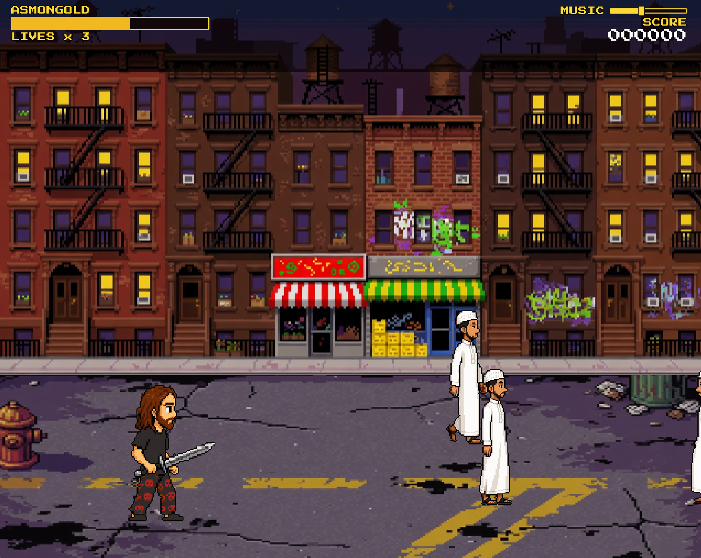
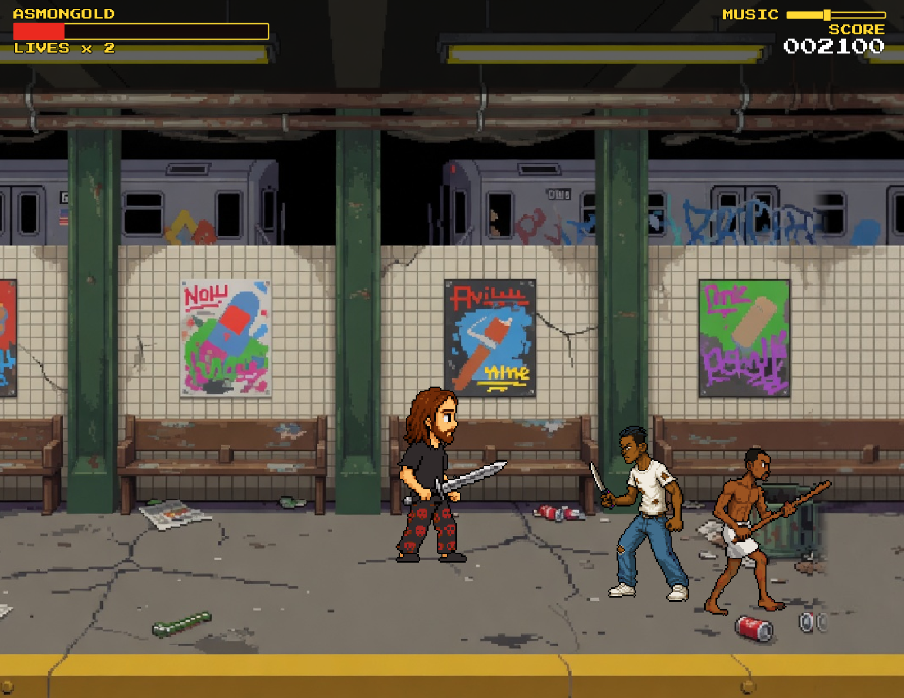

# Asmongold vs. the Migrants



A satirical side-scrolling beat-em-up inspired by *Final Fight* (1989) and *Double Dragon*. You play as Asmongold, clearing the street of a migrant invasion — and the Karens who protect them — on the way to woke / leftist final bosses.

(very early) demo at: https://asmongold-vs-migrants.web.app/

**Status: early prototype.** This is a playable tech demo, not a finished game. Movement, combat animation, camera, audio, and a Brooklyn street stage are in. Enemies, bosses, HUD, and stages beyond the first block are not.




## The pitch

You are Asmongold defending your convictions. You can choose between 2 modes:

### Regular mode

```
I used to blame migrants. Easy content.

Now it is 2030, I looked around. The doctors, the engineers, 
the ones bringing food at 2 a.m. — they’re not the enemy. 
More of them is better. They keep the lights on and the 
food coming. Diversity isn’t a slogan. 
It’s why this place still works.

The real enemy was always the middle-aged white man. 
The patriarchy. Guys like the one I used to be. 
Not anymore.

Hasan was right all along. Now I help the ones we import.
The stream changed. I changed.The enemy changed too.

No one is illegal on stolen land.

Asmongold.
```

### Offensive mode

```
They painted over the last street sign at dawn. 
By noon the district was marked “inclusive zone” 
and my stream got flagged for existing.

Doesn’t matter. The map still shows the choke 
points. Migrant packs hold the alleys. Woke cadres 
run the checkpoints and the propaganda towers. 
Both shoot first if you don’t kneel.

Your job is simple: clear the block, smash the 
towers, don’t let them rename the city while you’re 
still in it.

Load in. The West doesn’t defend itself. We do.

Asmongold.
```


## What’s in the prototype

- Playable Asmongold with idle, walk, and sword-strike animations
- 1280×1024 pixel-art Brooklyn street (five screens wide, camera scrolls)
- Walkable ground is the bottom third of the screen (beat-em-up plane)
- Sword swoosh SFX and a looping arcade-style BGM
- Built in **Godot 4.7** (GDScript)

## Controls

| Action | Keys |
|--------|------|
| Walk | Arrow keys |
| Sword strike | Space or X |

Up/down stay on the street. Left/right scroll the stage.

## What’s next

- Migrant enemy waves (grunts, groups, spawn from off-screen)
- Karens as interfering / protecting enemies
- Leftist / woke figures as final bosses
- Health, lives, score, and a *Final Fight*-style HUD
- Hitboxes, combo feel, and more attacks
- Additional city stages

## TODOs

* Enemies attacks
* New enemies for additional levels
* Bosses at the end of each levels
* Additional weapons
* Special attacks
* ...


## Run it

Open the project in Godot 4.7 and press Play (`F5`). Main scene is `res://scenes/main.tscn`.
