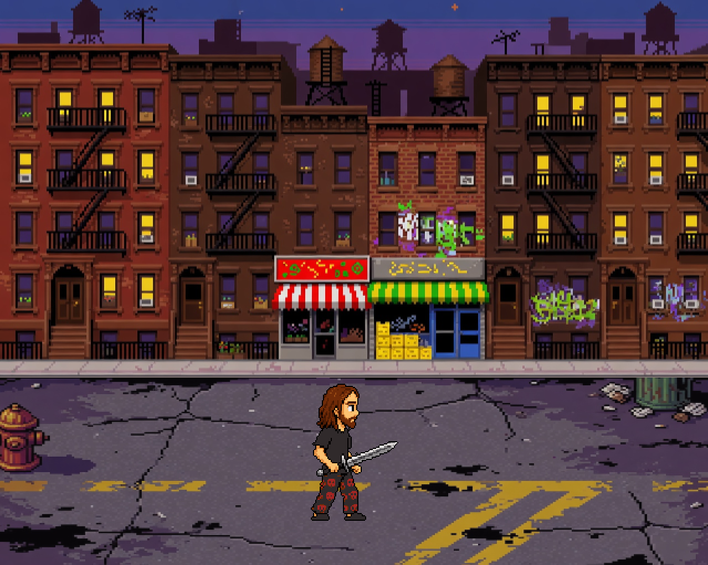

# Asmongold vs. the Migrants

A satirical side-scrolling beat-em-up inspired by *Final Fight* (1989) and *Double Dragon*. You play as Asmongold, clearing the street of a migrant invasion — and the Karens who protect them — on the way to woke / leftist final bosses.

(very early) demo at: https://asmongold-vs-migrants.web.app/

**Status: early prototype.** This is a playable tech demo, not a finished game. Movement, combat animation, camera, audio, and a Brooklyn street stage are in. Enemies, bosses, HUD, and stages beyond the first block are not.

## The pitch

Asmongold is dropped into a classic arcade brawler. The streets have been overrun. He has to fight through waves of migrants, deal with Karens who get in the way to protect them, and take down several leftist / woke figures as stage bosses — *Final Fight* structure, *Double Dragon* street-fight feel, pixel art, dusk city blocks.

## What’s in the prototype

- Playable Asmongold with idle, walk, and sword-strike animations
- 1280×1024 pixel-art Brooklyn street (five screens wide, camera scrolls)
- Walkable ground is the bottom third of the screen (beat-em-up plane)
- Sword swoosh SFX and a looping arcade-style BGM
- Built in **Godot 4.7** (GDScript)

## Controls

| Action | Keys |
|--------|------|
| Walk | Arrow keys |
| Sword strike | Space or X |

Up/down stay on the street. Left/right scroll the stage.

## What’s next

- Migrant enemy waves (grunts, groups, spawn from off-screen)
- Karens as interfering / protecting enemies
- Leftist / woke figures as final bosses
- Health, lives, score, and a *Final Fight*-style HUD
- Hitboxes, combo feel, and more attacks
- Additional city stages

## Run it

Open the project in Godot 4.7 and press Play (`F5`). Main scene is `res://scenes/main.tscn`.
